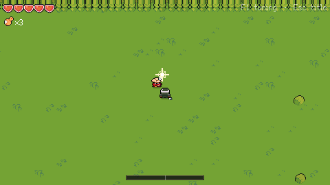
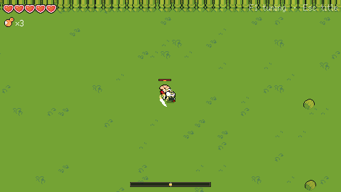

# Sword in the Forest · 林中剑

A top-down wuxia soulslike roguelike demo in Godot 4 (C#), in which the sword learns its
wielder: a Bayesian director estimates your reaction time and times enemy warnings to
the challenge you choose. **Work in progress**; see [docs/SPEC.md](docs/SPEC.md) and
[PROGRESS.md](PROGRESS.md).

## Build and test

Requirements: Godot 4.7.2 .NET and the .NET 8 SDK.

```bash
dotnet build && dotnet test      # libraries, unit tests, and the game assembly
tools/scenario.sh                # headless Godot scenario tests (bots, input, panel)
tools/screenshot.sh Title        # render a scene to docs/screens/ (needs a display or xvfb)
tools/screenshot.sh screens/Showcase "" 6000 x   # staged fight: saves combat_*.png
```

Open `game/project.godot` in Godot to play. Title → attack starts the test arena.

## Controls

| Action | Keyboard and mouse | Gamepad |
| --- | --- | --- |
| Move | WASD or arrows | Left stick |
| Aim | Mouse cursor | Right stick (else movement direction) |
| Attack (3-hit combo; finisher on a kneeling enemy) | Left click or J | X / □ (also RB) |
| Guard (hold) / deflect (tap after the glint) | Right click or K | LB / L1 |
| Roll | Space or L | A / ✕ |
| Gourd | R | Y / △ |
| Spare (later) | E | B / ○ |
| Back to title | Esc | Start |
| Tuning panel | F1 | |

 

## Layout

| Path | What |
| --- | --- |
| `game/` | Godot project (C#) |
| `src/Director/` | Director library, .NET Standard 2.1, no Godot |
| `src/Combat/` | Combat rules (attack timeline, response window, roll, posture, telemetry), no Godot |
| `tests/` | xUnit tests (Combat, Director, localization) |
| `sim/` | Simulator console app |
| `analysis/` | Python figures and report |
| `docs/` | Spec, report, figures, screenshots |

## Licence

Code is MIT. Assets are listed with their licences in [CREDITS.md](CREDITS.md).
