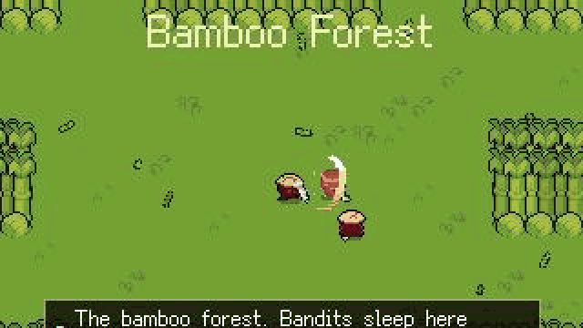
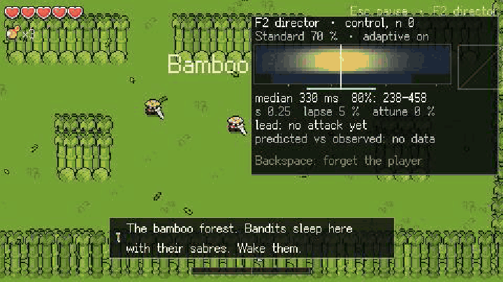
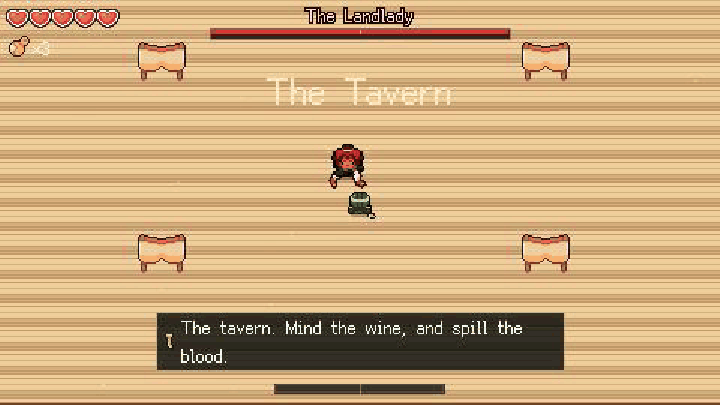

# Sword in the Forest · 林中剑

**A top-down wuxia soulslike where the sword learns its wielder.** You are a wandering soul who
takes up 鸣不平, a cursed sword sealed for sixty years in a bitter-bamboo forest. Fight through
the bamboo, past the tavern and into it, reading every enemy's glint and deflecting it. While
you fight, a small Bayesian model inside the sword estimates how fast *you* react, and times
each enemy's warning so the fight is as hard as the challenge you picked: no harder for slow
hands, no easier for fast ones.

A 10–15 minute vertical slice in Godot 4 (C#), in English, Nederlands and 简体中文.
**Play it on itch.io:** <https://rambledeng.itch.io/sword-in-the-forest> (Windows and Linux),
or grab a build from [Releases](../../releases).

| Deflect | The director learning a new player (F2) | The Landlady |
| --- | --- | --- |
|  |  |  |

## Controls

| Action | Keyboard and mouse | Gamepad |
| --- | --- | --- |
| Move | WASD or arrows | Left stick |
| Aim | Mouse cursor | Right stick (else movement direction) |
| Attack (3-hit combo; finisher on a kneeling enemy) | Left click or J | X / □ (also RB) |
| Guard (hold) / deflect (tap after the glint) | Right click or K | LB / L1 |
| Roll (the only answer to a red glint) | Space or L | A / ✕ |
| Gourd (heal) | R | Y / △ |
| Flash step 瞬步 (once the upgrade is taken) | Shift | RT / R2 |
| Spare a begging enemy | E | B / ○ |
| Pause, settings | Esc | Start |

Every enemy attack shows a **glint** a moment before it lands. White: block, deflect or roll.
Red (杀招): roll. Anything between the glint and the impact counts, so the glint's lead time
*is* your reaction window. That is the number the director tunes.

Broken enemies kneel (finish them) or beg (spare them, or don't). Not every beggar means it:
watch its eyes.

## How the director works

1. **Measure.** For every attack aimed at you: the lead time, whether you answered right, and
   when you pressed after the glint.
2. **Model.** Your reaction time is log-normal (median $e^m$, spread $s$) with a lapse rate
   $\lambda$ for misses that have nothing to do with speed. So the chance of answering an attack
   with lead $L$ is $P = (1-\lambda)\,\Phi\big((\ln(L-d)-m)/s\big)$, with $d$ the input delay.
3. **Update.** The belief over $(m, s, \lambda)$ lives on a ~3,000-cell grid. A new player
   starts from a population prior; each attack multiplies the grid by its likelihood (a
   histogram filter), with a slight blur so it can follow a player who warms up or tires.
4. **Control.** Each attack gets the shortest lead whose predicted success, averaged over the
   belief, reaches your challenge: Relaxed 85%, Standard 70%, Hard 55%, within 200–800 ms.
   There is no calibration phase: it controls from the first attack.

Only the reaction window adapts. Health, damage and attack patterns are the same for everyone.
Settings → Adaptive timing off restores every designed default.

**Does it work?** On 1,000 simulated players whose true reaction times are known
([the full report](docs/report.md), regenerated by `tools/report.sh`):

- **It learns fast.** The median error is 22 ms after 5 attacks and 15 ms after 15 (about one
  frame). After 15 attacks, 88% of players are within 40 ms.
- **It hits the chosen challenge.** 98.7% / 93.0% / 90.5% of players land within 10 points of
  the Relaxed / Standard / Hard target, against 40% / 28% / 22% with a fixed 420 ms lead.
- **It degrades gracefully** on populations the prior wasn't fitted to, and on bots whose
  reaction times follow a different distribution (ex-Gaussian).
- **Calibration wasn't worth it.** Because every press is timed, a dozen information-seeking
  "Psi" attacks learn nothing that ordinary attacks don't, so the tutorial teaches instead.

## Hidden values and Detail mode

On a first playthrough the sword keeps its numbers to itself. Merit (功德) shows only as a
short gold glitter, karma (业障) as a wisp of dark smoke, and the run summary words the
sword's reading of you ("quick", "still learning", "slow") instead of milliseconds. Beat the
Landlady once and **Detail mode** appears in Settings: it brings back the merit and karma
counts, your estimated reaction time with its range, and the attunement meter (人剑合一),
which shows how sure the sword is of you.

Developer tools (F1 live tuning, F2 the director overlay shown above, F3 jump/god mode) are
on in the editor and off in release builds. Start a release build with `-- --dev`, or set
`SWORD_DEV=1`, to turn them on.

## Architecture

```text
game/  (Godot 4.7 .NET project, C#)
  scripts/Actors     player, enemies, bots          ┐
  scripts/Run        rooms, the run, mercy, upgrades │ Godot nodes
  scripts/Ui         HUD, menus, F1/F2/F3 panels     │
  scripts/Core       DirectorService, settings ──────┼──► src/Director  (.NET Standard 2.1, no Godot)
  tuning/*.tres      every tunable number            │      grid filter, prior, Psi, control
  localization/      strings.csv (en, nl, zh_CN)     └──► src/Combat    (.NET Standard 2.1, no Godot)
                                                            attack timeline, response window,
sim/       simulator over src/Director → CSV                 roll, posture, mercy rules, telemetry
analysis/  evaluate.py: CSV → docs/figures + docs/report.md
tests/     xUnit: Combat, Director (incl. 1,000-player checks), Localization
game/scenes/scenarios/   headless Godot scenario tests (bots play seeded runs)
```

The rules that must be testable without an engine (the director, the attack timeline, the
response window, mercy) live in plain .NET libraries with unit tests. The Godot side wires them
to nodes, input and drawing, and is covered by ~30 headless scenarios in which bots play seeded
fights and runs. Everything random in a run is seeded, so a scenario replays frame for frame.

## Build and test

Requirements: [Godot 4.7.2 .NET](https://godotengine.org/download) and the .NET 8 SDK.
Python 3 with `analysis/requirements.txt` for the report.

```bash
dotnet build && dotnet test      # libraries, unit tests, and the game assembly
```

```bash
tools/scenario.sh                # headless scenario tests (all, or name some)
```

```bash
tools/report.sh                  # simulation study → docs/figures/*.png and docs/report.md
```

```bash
tools/gifs.sh                    # README GIFs with Godot's Movie Maker (needs xvfb and ffmpeg)
```

To play from source, open `game/project.godot` in Godot and press F5. To export, install the
4.7.2 .NET export templates and use the Windows or Linux preset in `game/export_presets.cfg`.
A `v*` tag runs `.github/workflows/release.yml`: it exports both builds, smoke-tests the Linux
one, attaches them to a GitHub Release and pushes them to itch.io with butler.

Design and progress notes: [docs/SPEC.md](docs/SPEC.md), [PROGRESS.md](PROGRESS.md).

## Credits

- Art, music and sounds: [Ninja Adventure Asset Pack](https://pixel-boy.itch.io/ninja-adventure-asset-pack)
  by Pixel-boy and AAA (CC0).
- Font: [Fusion Pixel Font](https://github.com/TakWolf/fusion-pixel-font) by TakWolf (OFL 1.1),
  with glyphs from Ark Pixel, Cubic 11 and Galmuri.
- The glint, sparks, the title's sword and seal, the tavern walls and the HUD are drawn in code.
- Built with [Godot Engine](https://godotengine.org).

Every asset, with its source path and licence, is listed in [CREDITS.md](CREDITS.md).
Code is MIT ([LICENSE](LICENSE)).
