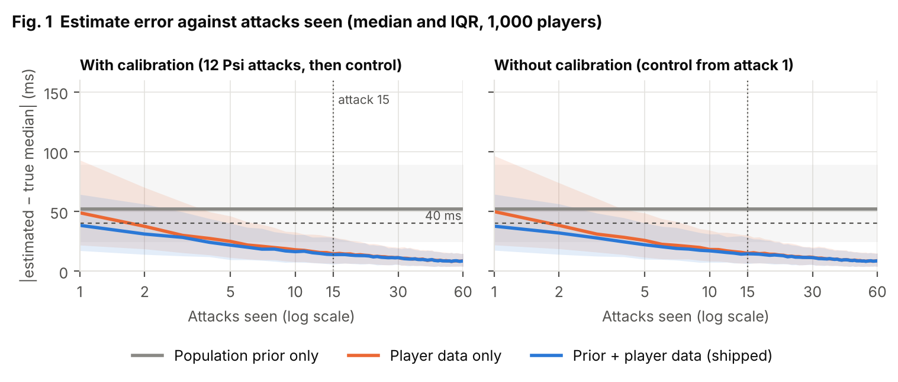
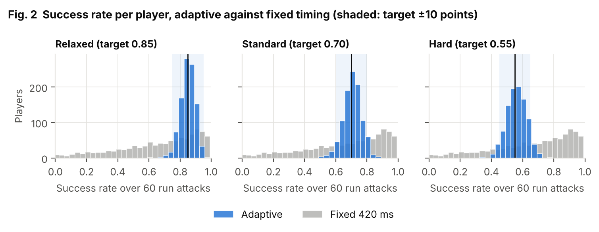
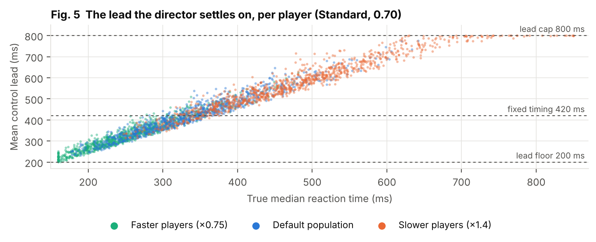
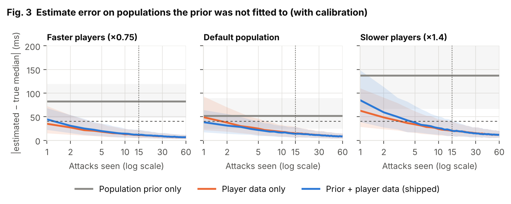
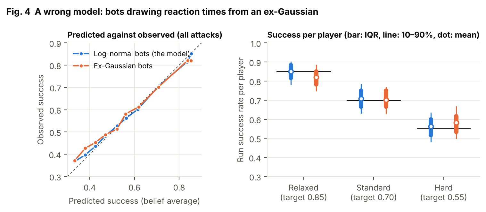

# The adaptive director: a simulation study

*Sword in the Forest (林中剑), milestone M5. Generated by `tools/report.sh`; do not edit
`docs/report.md` by hand. Its text is `analysis/report_template.md`, and every number is
computed by `analysis/evaluate.py` from the simulator's CSV.*

## Summary

The director estimates each player's reaction time from the attacks they face, then sets the
warning (lead) time so they succeed at the rate their challenge setting asks for. We test it on
1,000 simulated players whose true parameters are known (29 runs, 2,016,000
attacks in all). It answers four questions from the spec:

| Question | Result |
| --- | --- |
| How fast does it learn a new player? | Median error 22 ms after 5 attacks and 14 ms after 15. After 15 attacks 88.2% of players are within 40 ms. The population prior helps for the first few attacks only. Calibration adds nothing measurable. |
| Does it hit the chosen challenge? | 98.4% / 93.6% / 91.7% of players are within 10 points of the Relaxed / Standard / Hard target, against 40.4% / 28.1% / 21.0% with the fixed 420 ms lead. |
| Does it hold up on unfamiliar players? | Yes for faster players (93.4% on target). For slower players 89.0% are on target: the slowest 6.1% are limited by the 800 ms lead cap, not by learning. |
| Does it survive a wrong model? | Mostly. With ex-Gaussian bots, 94.0% are on target at Standard. Success is pulled toward the middle (Relaxed 0.820, Hard 0.582), and the 80% interval covers the truth only 68.8% of the time. |

The fifth question, "does it work on a real person?", needs your play logs and is left for the
playtest.

## Setup

**Players.** A player has a median reaction time $e^m$, a log-spread $s$ and a lapse rate
$\lambda$. The default population has a median of medians of 330 ms (log-sd 0.25, clamped
to 160–850 ms), $s \sim U(0.12, 0.38)$ and $\lambda \sim U(0, 0.10)$. Each attack, the bot
lapses (no press) with probability $\lambda$. Otherwise it presses after a log-normal
reaction time plus a 17 ms input delay, snapped to the next 60 Hz frame. A press up to 400 ms
after the impact is still timed, as in the game; later counts as no press. The test players use
seed 7; the prior was fitted to 20,000 different players (seed 2026).

**Director.** This is the shipped `src/Director` library, unchanged: a 2,976-cell grid
filter, a 3% blur per attack, Psi calibration and control at the target. A session is 12
calibration attacks and then 60 control attacks ("the run"). Run success is measured over the
60 control attacks.

**Conditions.**

- *Population prior only*: the shipped prior, never updated.
- *Player data only*: a flat prior over the grid.
- *Both*: the shipped prior plus the player's attacks (what the game does).
- *Without calibration*: control from the first attack, 60 attacks in all.
- *Fixed timing*: every attack at 420 ms, the designed default of the first slash.

Error is $|\hat{\text{median}} - \text{median}|$, using the posterior median of $e^m$.

## 1. How fast does it learn a new player?



| Median error (ms) after attack | 1 | 5 | 15 | 30 | 60 | Within 40 ms at 15 |
| --- | --- | --- | --- | --- | --- | --- |
| Population prior only | 52 | 52 | 52 | 52 | 52 | 39.6% |
| Player data only, calibration | 49 | 25 | 15 | 12 | 9 | 87.1% |
| Both, calibration (shipped) | 38 | 22 | 14 | 11 | 9 | 88.2% |
| Player data only, no calibration | 50 | 26 | 15 | 12 | 9 | 86.3% |
| Both, no calibration | 38 | 22 | 15 | 11 | 9 | 88.3% |

The prior alone is off by 52 ms for the typical player and never improves. That is the
"unseen participant" gap. With the player's own attacks, the error falls to 22 ms by attack 5
and 14 ms by attack 15, about one 60 Hz frame. The M2 target (40 ms after 15
attacks for 80% of players) is met at 88.2%.

Two findings were not expected:

- **The prior matters only at the start.** It cuts the first-attack error from
  49 to 38 ms. By attack 5 the gap is 25 against
  22 ms, and by attack 15 the curves overlap.
- **Calibration does not speed up learning here.** With and without the 12 Psi attacks, the
  curves are the same within noise. The reason is the evidence. The game times every press up
  to 400 ms after the impact, so almost every attack yields an exact reaction time, whatever the
  lead. The lead only decides where the press is censored. Psi's careful choice of lead buys
  information that a timed press already gives for free. It would matter if only success or
  failure were observed.

The estimate is honest about its doubt. The 80% interval holds the true median for
78.3% of players at attack 15 and 87.8% at attack 60. It is slightly
conservative late on, because the per-attack blur keeps it wide enough to follow a player who
changes.

## 2. Does it hit the chosen challenge?



| Challenge (target) | Adaptive: on target ±10 | Adaptive: mean (SD) | Fixed 420 ms: on target | Fixed: mean (SD) | Binomial SD floor |
| --- | --- | --- | --- | --- | --- |
| Relaxed (0.85) | 98.4% | 0.851 (0.046) | 40.4% | 0.672 (0.252) | 0.046 |
| Standard (0.70) | 93.6% | 0.707 (0.057) | 28.1% | 0.672 (0.252) | 0.059 |
| Hard (0.55) | 91.7% | 0.562 (0.062) | 21.0% | 0.672 (0.252) | 0.064 |

A fixed lead is right for nobody in particular. It ranges from trivial for fast players to
nearly impossible for slow ones (SD 0.252). Adaptive timing puts nearly
everyone in the band. Its spread matches the binomial floor: the noise you get from 60 coin
flips at exactly the target. So almost all the variation left is luck, not mistuning.

The prior alone gets the *average* right (0.710 at Standard), but only
27.8% of individual players are on target. Personal data, not the prior, makes
the challenge fair.



Fig. 5 shows how. The control lead grows almost linearly with the true median. The spread at a
given median comes from the player's spread and lapse rate: an erratic player needs a longer
lead to succeed 70% of the time. The two clamps show at the ends. The fastest players
(population clamped at 160 ms) sit on the 200 ms floor and get it slightly easy. The slowest sit
on the 800 ms cap (section 3).

## 3. Does it hold up on unfamiliar players?

The prior stays the one fitted to the default population. The test players are drawn from the
same population with every median scaled by 0.75 (median of medians ≈ 250 ms) or by 1.4
(≈ 460 ms). Each player keeps its z-score, so the three populations are paired.



| Population | Prior only: error | Both: error at 15 / 60 | Within 40 ms at 15 | On target (Standard): adaptive | Fixed 420 ms |
| --- | --- | --- | --- | --- | --- |
| Faster (×0.75) | 82 ms | 12 / 7 ms | 94.0% | 93.4% (mean 0.724) | 17.4% (mean 0.867) |
| Default | 52 ms | 14 / 9 ms | 88.2% | 93.6% (mean 0.707) | 28.1% (mean 0.672) |
| Slower (×1.4) | 137 ms | 20 / 12 ms | 74.2% | 89.0% (mean 0.678) | 11.7% (mean 0.308) |

A wrong prior costs a few attacks, not the session. On the slower population the prior
starts far off and pulls the first estimates toward 330 ms. The shipped director then trails
the flat prior for the first handful of attacks, and catches up by about attack 10. At attack
15, 74.2% are within 40 ms, below the 80% bar the default population meets.
But the error keeps falling, to 12 ms by attack 60. The 2% floor in the
prior is what makes this recovery possible. The faster population is learned *faster* than the
default one, because short reaction times are less noisy in milliseconds.

The remaining gap at the slow end is a design limit, not an estimation error. Leads stop at
800 ms. A player whose median is above about 620 ms cannot reach 70% at
any lead the game allows. That is 6.1% of the slower population, with a mean
success of 0.538. Without them, 92.7% of slower players are on
target.

## 4. Does it survive a wrong model?

Real reaction times are often better described by an ex-Gaussian: a normal $(\mu, \sigma)$
plus an exponential tail $\tau$. It is sharper on the fast side and heavier on the slow side
than a log-normal with the same median. Each bot here keeps a default-population player's median and lapse rate. It
draws $\sigma$ as 6–15% of the median and $\tau$ as 20–50% of it (median $\tau$/median
0.36), then solves for $\mu$ so the median is unchanged.



| Challenge (target) | Ex-Gaussian: on target | Mean (SD) | Fixed 420 ms: on target | Log-normal: mean |
| --- | --- | --- | --- | --- |
| Relaxed (0.85) | 94.6% | 0.820 (0.048) | 36.5% | 0.851 |
| Standard (0.70) | 94.0% | 0.702 (0.058) | 38.2% | 0.707 |
| Hard (0.55) | 87.6% | 0.582 (0.063) | 30.0% | 0.562 |

The director still works, and it fails gracefully. Averaged over all attacks, its predictions
stay close to what happens. The weighted gap between predicted and observed success is
2.0 points, against 0.4 for log-normal bots. But the misfit has a
direction. Success is pulled toward the middle:

- **Relaxed is too hard:** mean 0.820 against 0.85.
- **Hard is too easy:** mean 0.582 against 0.55.
- **Standard is right:** mean 0.702.

The cause is the finding from section 1. Almost every press is timed, whatever the lead, so the
filter fits a log-normal to the player's *whole* reaction-time distribution, not just to the
part near the leads it uses. The best overall log-normal matches the ex-Gaussian in the bulk,
near the median and Standard's leads. Its success curve is steeper than the true one further
out. Above the bulk, the long exponential tail holds more slow presses than the fit expects,
so long (Relaxed) leads succeed less often than predicted. Below it, short (Hard) leads succeed
more often.

The median estimate is biased by +14 ms (median, after 72 attacks). Its 80%
interval covers the truth only 68.8% of the time, because the filter is confident in a
model that is not quite right. In play this means the three challenge settings are a little
closer together than their labels say. For a real person, the logs will show whether this
matters. If it does, the cheapest fix is a third shape parameter, or a per-challenge offset
learned from the predicted-against-observed record the F2 overlay already keeps.

## Limits and next steps

- **Every player here is a bot.** The model's real test is your play logs: the fifth question.
  The prior should be refit from them, as the spec plans.
- **Players don't change during a session here.** The blur exists for players who improve or
  tire; a drifting-player experiment would test it.
- **One distribution covers deflects and rolls.** Red attacks may need their own offset.
- **The lead cap (800 ms) is a design choice.** Section 3 shows its cost for very slow
  players: 6.1% of a population 40% slower than ours. Raising it, or letting very slow
  players fall back to a lower target, is a playtest question.
- **Calibration.** Since it does not speed up learning in this setting (section 1), the
  tutorial could drop it and use those attacks for teaching, with no loss of accuracy. That is a
  design decision for M3.

## Reproduce

```bash
tools/report.sh
```

It runs the simulator (`dotnet run --project sim -c Release -- --study m5`, about 30 s), writes
the CSV to `analysis/out/`, and then runs `analysis/evaluate.py`. That script draws
`docs/figures/*.png` and fills this template into `docs/report.md`. Everything is seeded, so a
rerun gives the same numbers.
